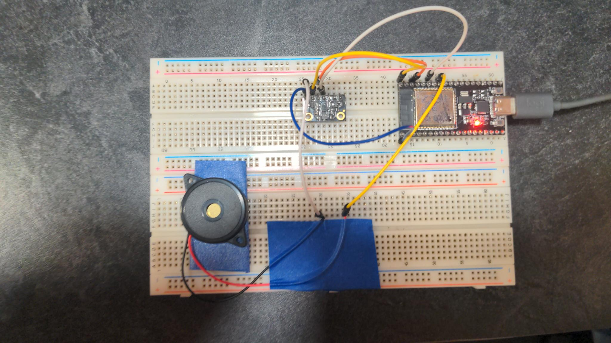
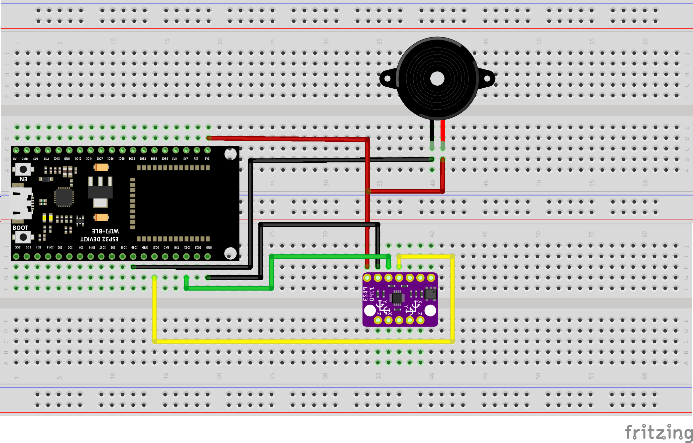
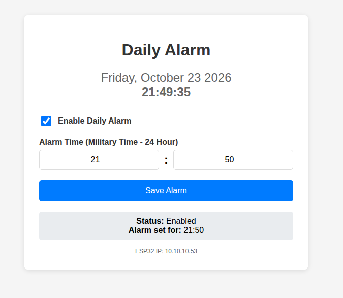

# ENT401 Group Project - Smart Alarm System

This project is an ESP32-based smart alarm system with a web interface. It uses a BMX160 9-axis motion sensor and a buzzer for alerts.

## Demo

### Live Demo

https://github.com/user-attachments/assets/9c5c4756-6135-47e3-aa7f-98d63e77e5f7

### Web Interface Demo

https://github.com/user-attachments/assets/dd90cc17-dacf-4480-a380-2a6b942102c9

## Features

- **Wi-Fi Connectivity**: Connects to "hotspot1" network
- **NTP Time Sync**: Automatically syncs time with pool.ntp.org
- **Eastern Time with DST**: Configured for Columbus, Ohio (EST/EDT) with automatic daylight saving time transitions
- **Web Interface**: Control the alarm from any device on the same network
- **Daily Alarm**: Set a daily alarm in military time (24-hour format) that rings every day
- **Persistent Storage**: Alarm settings saved in ESP32 flash memory (Preferences)
- **Motion Sensing**: BMX160 sensor monitors acceleration, gyroscope, and magnetometer
- **Audio Alert**: Buzzer produces alarm sounds when triggered

## Hardware Components

- ESP32 Development Board
- DFRobot BMX160 9-Axis Sensor (I2C)
- Buzzer (connected to GPIO 19)
- Breadboard and jumper wires

## Wiring Diagram

### Physical Wiring



### Schematic



### Connections

| Component | ESP32 Pin | Notes |
|-----------|-----------|-------|
| BMX160 VCC | 3.3V | Power |
| BMX160 GND | GND | Ground |
| BMX160 SDA | GPIO 21 | I2C Data |
| BMX160 SCL | GPIO 22 | I2C Clock |
| Buzzer (+) | GPIO 19 | Signal (via transistor/resistor recommended) |
| Buzzer (-) | GND | Ground |

## Web Interface



The web interface allows you to view the current time in military format, enable/disable the alarm, and set the hour and minute using simple number inputs.

## User Guide: Setting and Silencing the Alarm

### Setting the Alarm

1. **Power On**: Plug the ESP32 into power. It will automatically connect to the Wi-Fi network configured in the program and sync the time.
2. **Find the IP Address**: Open the Arduino Serial Monitor (115200 baud) to see the ESP32's IP address (e.g., `192.168.1.100`).
3. **Open the Web Interface**: On any device connected to the same Wi-Fi network, open a web browser and go to `http://<ESP32-IP-ADDRESS>`.
4. **Set Your Alarm Time**: Under "Alarm Time (Military Time - 24 Hour)", enter the hour (0-23) and minute (0-59) you'd like the alarm to go off.
5. **Enable the Alarm**: Check the box labeled "Enable Daily Alarm".
6. **Save**: Click "Save Alarm". Your settings will be saved and will persist even if the ESP32 is powered off and back on.
7. **Verify**: The status at the bottom of the page will show "Enabled" and the time you set.
8. **Silencing**: To silence the alarm shake the esp32 board and the imu will detect the movement and shut off the buzzer.

## Setup Instructions (For Developers)

### 1. Install USB-to-Serial Drivers

Depending on your ESP32 board, you may need a USB driver:

| Board Type | Driver | Download Link |
|------------|--------|---------------|
| CP210x (Common on many ESP32 dev boards) | Silicon Labs CP210x USB to UART Bridge VCP Drivers | [https://www.silabs.com/developers/usb-to-uart-bridge-vcp-drivers](https://www.silabs.com/developers/usb-to-uart-bridge-vcp-drivers) |
| CH340/CH341 (Very common cheap boards) | CH340/CH341 USB Driver | [https://sparks.gogo.co.nz/ch340.html](https://sparks.gogo.co.nz/ch340.html) or [https://github.com/nodemcu/nodemcu-devkit-v1.0/blob/master/Drivers/CH341SER.EXE](https://github.com/nodemcu/nodemcu-devkit-v1.0/blob/master/Drivers/CH341SER.EXE) |
| FTDI (Some boards) | FTDI VCP Drivers | [https://ftdichip.com/drivers/vcp-drivers/](https://ftdichip.com/drivers/vcp-drivers/) |

**Tip**: If your board isn't detected after plugging in, try one of these drivers based on the USB chip on your board.

### 2. Install Arduino IDE and ESP32 Support

1. Download and install the [Arduino IDE](https://www.arduino.cc/en/software) (version 1.8.x or 2.x)
2. Open Arduino IDE, go to `File > Preferences`
3. Add this URL to "Additional Boards Manager URLs": `https://raw.githubusercontent.com/espressif/arduino-esp32/gh-pages/package_esp32_index.json`
4. Go to `Tools > Board > Boards Manager`, search for "esp32" and install "esp32 by Espressif Systems"

### 3. Install Required Libraries

Go to `Sketch > Include Library > Manage Libraries` and install the following:

- `DFRobot_BMX160` by DFRobot
- (The other libraries: `Wire`, `WiFi`, `WebServer`, `Preferences`, `time` are built into the ESP32 Arduino core)

### 4. Wire and Upload

1. Connect hardware according to the wiring diagram above
2. Connect ESP32 to your computer via USB
3. Select your board: `Tools > Board > ESP32 Arduino > ESP32 Dev Module`
4. Select the correct port: `Tools > Port > (your COM/ttyUSB port)`
5. Open `ArduinoProgram/ArduinoProgram.ino` in Arduino IDE
6. Click Upload
7. Open Serial Monitor at 115200 baud to view connection status and IP address

### 5. Configure Wi-Fi (Optional)

The default credentials are set to `hotspot1` / `hotspot1`. If you need to change them, edit these lines in `ArduinoProgram.ino`:

```cpp
constexpr char WIFI_SSID[] = "hotspot1";
constexpr char WIFI_PASSWORD[] = "hotspot1";
```
